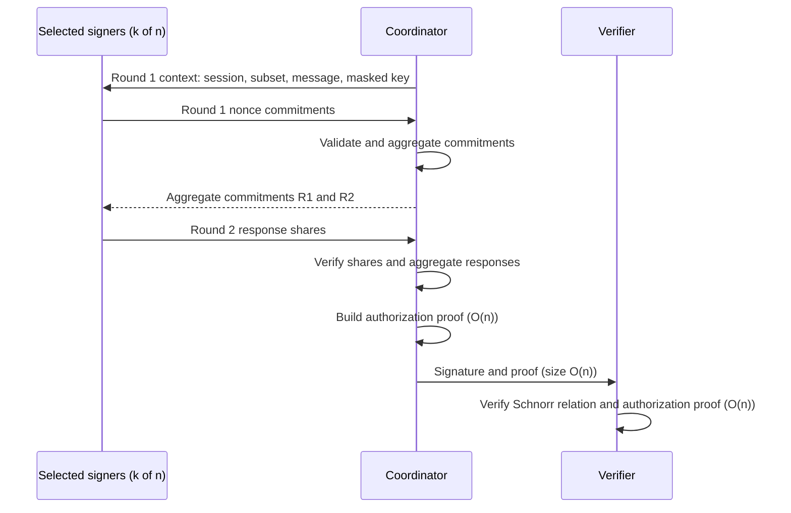
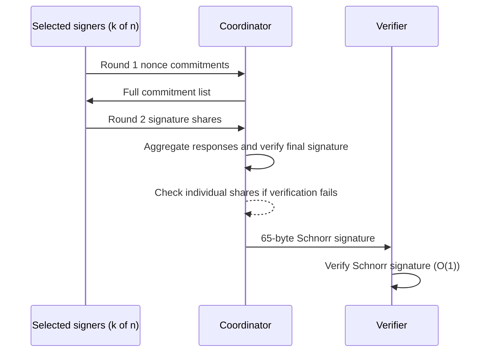
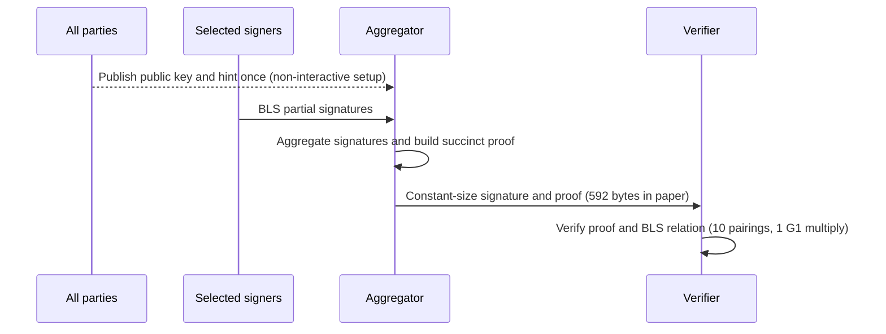

# Threshold Signature Benchmark Report

**Status:** exploratory research measurements. Audit v5 is the HTA scheme source. Results and tests do not establish security. This report presents each scheme separately because their setup, functionality, and measured stages differ.

**FROST baseline updated:** Previous FROST figures and ratios are withdrawn. Section 7 reports the new Zcash Foundation measurements; historical HTA and hinTS results retain their original methodology.

## 1. Executive summary

The local HTA and Zcash FROST measurements use secp256k1 and matching `(n,t,k)` configurations. HTA adds a roster-based authorization proof: its signature size and full verification cost grow with `n`. FROST produces a compact Schnorr signature and has constant-size final verification. See Section 7 for the replacement measurements and their different aggregation behavior.

The local hinTS code run measures proof construction and proof-equation checks only. It does not measure complete hinTS signing or verification. Paper results are listed separately and were collected on different hardware.

## 2. Protocol and implementation profiles

### 2.1 HTA

| Item | Implementation detail |
|---|---|
| Group | secp256k1 prime-order group; compressed points are 33 bytes; scalars are 32 bytes. |
| Hashing | SHA-256 for typed, length-prefixed transcripts and domain-separated scalar challenges. Generator derivation uses RFC 9380 `secp256k1_XMD:SHA-256_SSWU_RO_`, DST `HTA-v1-secp256k1-Hgen`. |
| Backend | Pinned mcl public arithmetic; OpenSSL 3 for SHA-256 and randomness. Secret arithmetic is variable-time research code. |
| Protocol | Independent signer keys, two signing rounds, dynamic per-message threshold, roster-based authorization proof, share verification, and final verification. No DKG or pairing SRS. See audit v5 Algorithms 1–2 and checks C1–C4. |
| Measured optimizations | Randomized batch verification, generator cache, public fixed-base multiplication, public MSM component comparison, and proof-generator table experiment. Proof-generator tables remain disabled. |

### 2.2 FROST

| Item | Implementation detail |
|---|---|
| Source | [Zcash Foundation FROST, pinned commit](https://github.com/ZcashFoundation/frost/tree/0966bd1529aa062ad3b621af99e277f976b1c0f0), following [RFC 9591](https://www.rfc-editor.org/rfc/rfc9591.html#section-6.5). |
| Ciphersuite | `FROST(secp256k1, SHA-256)`, context `FROST-secp256k1-SHA256-v1`. H1–H3 use RFC 9380 XMD-to-scalar with `rho`, `chal`, `nonce` domains. H4/H5 use `msg` and `com`. |
| Key setup | The benchmark uses the library's trusted-dealer Shamir key generation and configuration setup; it does not run DKG. The threshold is fixed by the key configuration. |
| Signature | One compressed point and one scalar: 65 serialized bytes in this implementation. Rust release build in `rust:1` Docker image. |

### 2.3 hinTS

| Item | Paper construction | Local repository code run |
|---|---|---|
| Source | [hinTS paper](https://eprint.iacr.org/2023/567.pdf). | [Upstream source commit](https://github.com/hintsrepo/hints/tree/930fd3cccd8caf08f16924bb6fe55611f3f1f2f6). |
| Group and hash | BLS12-381 (G1, G2, Fr), KZG SRS, BLS hash-to-curve. Paper cites CFRG hash-to-curve draft-12 and Arkworks. | Declares BLS12-381 and Arkworks 0.4 family. The measured functions do not call hash-to-curve. |
| Setup and threshold | Dynamic threshold; one-time per-party hints and KZG-based public state. | Hardcodes n=64, has no threshold input/check, and initializes with deterministic `test_rng`. Setup is outside the timed section. |
| Measured functionality | Full BLS signing and succinct certificate according to the paper. | `Proof` has no message or BLS signature; timed verifier checks proof equations only. This is a proof microbenchmark, not full hinTS signing or verification. Rust 1.99.1. |
| Size | Paper reports 9 G1 + 5 Fr = 592 bytes. | No serialization output. |

MiMC is used in the paper's separate SNARK/EdDSA comparison, not in its hinTS BLS construction.

## 3. Protocol flows

### 3.1 HTA

### 3.2 FROST

### 3.3 hinTS paper protocol

## 4. Asymptotic time and space complexity

Let `n` be roster size, `k` selected signers, `t` threshold, and `MSM(m)` an m-base multi-scalar multiplication. These are protocol/source bounds, not measured memory use. The FROST API costs observed in the benchmark are noted separately.

### 4.1 HTA complexity

| Phase or state | Time | Space |
|---|---|---|
| Key registration and roster | O(1) key/PoP per party; O(n) total validation | O(n) roster |
| Generator derivation | O(n) hash-to-curve calls for `2N+1` bases | O(n) generators |
| Signing | O(1) arithmetic per signer in two rounds; O(k) across signers, excluding context/subset parsing | O(1) key/nonces per live signer session |
| Aggregation and authorization proof | O(k) commitment/response sums; O(n) proof work using several O(n)-base MSMs | O(n) proof working state |
| Share and final verification | O(k) share checks; O(n) MSM/group and field terms for full verification | O(n) roster and proof/signature |
| Signature | O(n) | Measured size: 1,467 B at n=8; 5,833 B at n=64 |

### 4.2 FROST complexity

| Phase or state | Time | Space |
|---|---|---|
| Trusted-dealer setup | Approximately O(nt) field work for a degree-t sharing; DKG is outside RFC 9591 and this benchmark | O(n) public shares; O(1) secret share per signer |
| Round 1 | O(1) per signer; O(k) across signers | O(k) commitments at coordinator |
| Round 2 | Each signer processes k commitments; serialized total work is O(k²) in this benchmark | O(k) commitment list and shares |
| Share checks | The measured Zcash aggregation first verifies the combined signature; individual share checks occur only after failure. | O(k) session state |
| Final verification and signature | O(1) final verification and 65-byte signature in the Zcash encoding | O(1) signature |

### 4.3 hinTS complexity from the paper

| Phase or state | Time | Space |
|---|---|---|
| Silent setup | Per-party hint generation: O(n) group multiplications and O(n log n) field work. Aggregator preprocessing: O(n²). | O(n) per-party hint; O(n²) total hints; O(n) CRS and aggregator key; O(1) verification key |
| Signing and aggregation | O(1) BLS partial signature per signer; O(n) online aggregate group work. Paper reports O(n/log n) for its Pippenger MSM component. | O(n) aggregator key/state; O(1) aggregate signature/proof |
| Verification | O(1) in n; paper reports 10 pairings and 1 G1 multiplication | O(1) verification key, in addition to CRS material |
| Signature | O(1) | Paper reports 592 bytes |

## 5. Historical measurement methodology

This section and Section 6 document the older HTA experiment. The historical FROST column describes the withdrawn Go baseline; it does not describe the Zcash Foundation measurements in Section 7.

| Item | HTA | FROST |
|---|---|---|
| Host | Linux x86_64, Intel Core i5-1240P | Same host |
| Build | GCC 13.3, Release `-O3 -DNDEBUG`, mcl `9f49ba06593e2d426ab6fb9b0e17bc125a6f720c` | Go 1.26.3; pinned module checksums |
| Repetitions | 5 launches × 5 grouped samples × 5 sessions/group | 5 launches × 25 sessions after warmup |
| Execution | Signers sequential in one process | Signers sequential in one process |
| Setup measured | Deterministic test-key registration/PoP and roster validation; generator derivation excluded | Trusted-dealer keygen and configuration |

The historical HTA table in Section 6 uses medians in milliseconds unless labeled otherwise. Section 7 describes the new comparison's separate methodology. Timers measure elapsed wall time for sequential in-process work, not CPU time or network latency. Peak RSS and complete wire traffic were not measured; confidence intervals were not calculated.

## 6. HTA local results

### 6.1 Individually timed stages

Each column is a separate `(n,t,k)` configuration. HTA's full verification includes the authorization proof.

| Stage (ms unless noted) | 8,4,4 | 8,4,5 | 16,8,8 | 32,16,16 | 64,32,32 |
|---|---:|---:|---:|---:|---:|
| Registration and roster | 2.03 | 1.84 | 4.27 | 7.67 | 14.25 |
| Round 1 | 1.00 | 1.25 | 2.72 | 7.80 | 27.08 |
| Aggregate commitments | 0.34 | 0.40 | 0.60 | 1.08 | 2.14 |
| Round 2 | 0.45 | 0.57 | 0.93 | 1.82 | 3.84 |
| Verify shares | 0.76 | 0.96 | 1.56 | 3.09 | 6.52 |
| Aggregate responses | 0.098 | 0.100 | 0.102 | 0.105 | 0.116 |
| Authorization proof | 2.92 | 2.94 | 4.89 | 8.48 | 15.73 |
| Full verification | 1.90 | 1.90 | 2.97 | 4.86 | 8.60 |
| Serialized signature (bytes) | 1,467 | 1,467 | 2,133 | 3,391 | 5,833 |

The n=8 results have different k values but identical signature sizes, consistent with size depending on n rather than k. From n=8 to n=64, full verification grows from 1.90 ms to 8.60 ms and signature size from 1,467 B to 5,833 B.

## 7. Zcash FROST comparison

The prior Bytemare results and derived speed ratios are withdrawn. That driver repeatedly prepared commitment lists for each signer and share check; its timings were not a protocol-level comparison.

The table uses `t=k=n/2`, except `n=2` uses `t=k=2`, the minimum accepted by FROST. Times are milliseconds. HTA values are medians of five single-session samples from one launch; FROST values are one session per configuration, with no warmup. Runs use the same unpinned Intel i5-1240P host, sequential signers and different implementations/languages. Larger HTA runs were collected separately on an earlier build and an interrupted FROST run overlapped the beginning of the n=2,048 HTA process. The binary was already built, so its source snapshot is not proof of binary provenance. These exploratory measurements are not stable speed ratios.

| n | t=k | HTA round 1 | HTA round 2 | HTA prove | HTA full verify | FROST round 1 | FROST round 2 | FROST aggregate | FROST verify |
|---:|---:|---:|---:|---:|---:|---:|---:|---:|---:|
| 2 | 2 | 0.45 | 0.27 | 1.63 | 1.25 | 0.40 | 0.83 | 1.08 | 0.52 |
| 4 | 2 | 0.49 | 0.26 | 2.12 | 1.42 | 0.23 | 0.31 | 0.32 | 0.18 |
| 8 | 4 | 1.44 | 0.49 | 3.20 | 2.03 | 0.48 | 0.85 | 0.37 | 0.17 |
| 32 | 16 | 7.50 | 1.75 | 8.40 | 4.64 | 1.32 | 6.11 | 0.51 | 0.13 |
| 64 | 32 | 24.65 | 3.47 | 14.65 | 7.78 | 2.15 | 17.42 | 0.66 | 0.13 |
| 128 | 64 | 51.90 | 4.23 | 15.12 | 7.94 | 4.48 | 68.04 | 1.18 | 0.11 |
| 256 | 128 | 205.15 | 8.77 | 29.37 | 15.10 | 8.44 | 273.56 | 2.29 | 0.11 |
| 512 | 256 | 978.25 | 24.64 | 71.20 | 34.42 | 17.20 | 1,082.82 | 4.45 | 0.10 |
| 1,024 | 512 | 3,500.92 | 39.36 | 111.33 | 53.08 | 42.73 | 5,377.28 | 10.65 | 0.12 |
| 2,048 | 1,024 | 11,488.26 | 73.99 | 188.46 | 89.64 | 86.78 | 32,534.25 | 37.84 | 0.23 |

Round timings sum work across selected signers. Zcash `aggregate` verifies the final Schnorr signature and checks individual shares only if it fails; HTA's separately measured individual share checks are not in the table. FROST final verification checks a different statement from HTA's full verification. Zcash dealer generation and conversion/validation of all participant shares are separate: at n=2,048 they took 397.61 ms and 86,140.41 ms respectively. These are not equivalent to HTA registration and roster validation. At n=2,048 the encoded HTA signature is 153,019 bytes versus 65 bytes for this FROST encoding.

### 7.1 Total measured stage time

The following values are **derived sums of timed stages**, not measured end-to-end elapsed time. They exclude setup, communication, serialization, untimed preparation, and process startup. They are sequential work in one process, not parallel or network latency.

- HTA signing total sums Round 1, commitment aggregation, Round 2, individual share verification, response aggregation, and authorization proving. The total including verification adds full signature verification. For each of the five samples, the stages are summed before taking the median.
- FROST signing total sums Round 1, Round 2, and aggregation. Its aggregation verifies the combined signature and performs individual share checks only when that verification fails. The total including verification additionally includes the separate final verification. Each number is based on one session.

The stage sets have different functionality and verification policies. In particular, FROST's final Schnorr verification is not equivalent to HTA's signature-plus-authorization verification. These totals should not be interpreted as complete protocol latency or direct estimates of relative performance.

| n | t=k | HTA signing total (ms) | FROST signing total (ms) | HTA signing + verify (ms) | FROST signing + verify (ms) |
|---:|---:|---:|---:|---:|---:|
| 2 | 2 | 3.25 | 2.31 | 5.58 | 2.82 |
| 4 | 2 | 3.66 | 0.86 | 5.55 | 1.04 |
| 8 | 4 | 7.86 | 1.70 | 9.71 | 1.88 |
| 32 | 16 | 21.81 | 7.94 | 26.52 | 8.07 |
| 64 | 32 | 50.60 | 20.23 | 58.61 | 20.36 |
| 128 | 64 | 80.70 | 73.69 | 88.64 | 73.80 |
| 256 | 128 | 262.29 | 284.29 | 277.04 | 284.40 |
| 512 | 256 | 1,112.27 | 1,104.47 | 1,145.47 | 1,104.57 |
| 1,024 | 512 | 3,726.64 | 5,430.67 | 3,778.43 | 5,430.79 |
| 2,048 | 1,024 | 11,906.34 | 32,658.87 | 11,995.98 | 32,659.10 |

### 7.2 One-time setup measurements

Setup is reported separately because the protocols perform different operations. HTA measures deterministic test-key registration, proofs of possession, and roster validation; generator derivation is excluded. FROST sums trusted-dealer key generation and conversion/validation of all participant shares. These setup times must not be added to the signing totals as a per-signature cost without specifying how many sessions reuse the setup.

| n | t=k | HTA registration and roster (ms) | FROST dealer + share validation (ms) |
|---:|---:|---:|---:|
| 2 | 2 | 0.65 | 1.38 |
| 4 | 2 | 0.81 | 1.22 |
| 8 | 4 | 1.68 | 3.59 |
| 32 | 16 | 10.88 | 35.68 |
| 64 | 32 | 14.02 | 96.48 |
| 128 | 64 | 16.13 | 323.28 |
| 256 | 128 | 35.77 | 1,124.58 |
| 512 | 256 | 68.48 | 4,303.92 |
| 1,024 | 512 | 127.66 | 19,681.57 |
| 2,048 | 1,024 | 214.77 | 86,538.02 |

HTA setup values are medians of five registration runs; FROST setup values are sums from one run. Neither includes a distributed key generation protocol. HTA and FROST setup are not equivalent operations.

Raw [FROST samples](docs/benchmarks/phase5-zcash-frost-20261112.jsonl), [HTA n=2–64 samples](docs/benchmarks/phase5-hta-zcash-serial-20261112/) and [HTA n=128–2,048 samples](docs/benchmarks/phase5-hta-large-20261112/) include metadata. The [driver](tools/zcash_frost_matrix.rs) checks valid verification, wrong-message rejection and signature serialization; the [runner](tools/run_zcash_frost.py) saves each completed configuration.

To rebuild the pinned upstream example, copy the driver to `another_implementation/frost/frost-secp256k1/examples/hta_matrix.rs`, then run `docker run --rm -v "$PWD/another_implementation/frost:/work" -w /work rust:1 cargo build --release --locked -p frost-secp256k1 --example hta_matrix`. The runner appends to its output file; use a fresh output file or remove the previous results before rerunning. The image used here was `rust:1` digest `sha256:8a4e90c7946b74626488b1446f712c0fe0ed1a596cbd3d871684bc9c5433ae07`.

The requested upstream is [Zcash Foundation FROST](https://github.com/ZcashFoundation/frost), checked out at `0966bd1529aa062ad3b621af99e277f976b1c0f0` under ignored `another_implementation/frost`. For the requested TRS, TAPS and PPMS papers, a search of the papers and public sources did not locate author-linked implementations of those exact constructions. No benchmark is claimed for them: [TRS (2002)](https://www.iacr.org/archive/crypto2002/24420467/24420467.pdf), [TAPS (2022)](https://eprint.iacr.org/2022/1636.pdf), [PPMS (2024)](https://eprint.iacr.org/2023/1884.pdf), and [PPMS (2025)](https://eprint.iacr.org/2025/335.pdf). This search is not proof that code does not exist.

### 7.3 Selected related implementations

| Implementation | Relationship to HTA | Experiment status |
|---|---|---|
| [LoTRS](https://github.com/lotrs-sig/lotrs) | A lattice-based threshold ring signature with an author-linked implementation and benchmark harness. It has different cryptographic assumptions and protocol costs from HTA. | Selected for comparison; no local measurements collected. |
| [DeTAPS](https://github.com/IINSLab/DeTAPS) | A related private threshold-signature construction with decentralized tracing and accountability, additional functionality not provided by HTA. | Selected for comparison; no local measurements collected. The documented prototype uses Ethereum and SGX. |

The existing FROST and HTA measurements must not be presented as measurements of LoTRS or DeTAPS. Their implementations, setup, feature sets, and runtime conditions require separate verification before a comparison is reported.

### 7.4 Theory and observations

| Property | Expected structure | Observed evidence and qualification |
|---|---|---|
| HTA proof and full verification | Roster-sized proof vectors and O(n)-term MSMs; see audit v5 Algorithm 2 and checks C1–C4. | From n=64 to n=2,048, proof median increased from 14.65 to 188.46 ms and full verification median from 7.78 to 89.64 ms. These samples do not prove asymptotic complexity. |
| Signature size | HTA includes a roster-sized proof; FROST encodes a single Schnorr signature. | HTA grows from 5,833 bytes at n=64 to 153,019 bytes at n=2,048. FROST is 65 bytes in every recorded configuration. The HTA figure includes this implementation's serialization framing. |
| FROST final verification | Constant work in roster size when the group verification key is available. | Individual measurements range from 0.10 to 0.52 ms; one observation per size is insufficient to establish statistical stability. |
| Signing work | HTA performs constant core signing arithmetic per signer, excluding context processing. The measured FROST Round 2 processes the commitment list for each signer. | HTA Round 1 and FROST Round 2 both grow with selected signer count, but the values include implementation-specific processing and cannot be treated as protocol-level lower bounds. |

The paper's compact point-and-scalar size formula and the measured HTA serialized size have different accounting boundaries; use the actual serialized bytes when reporting this implementation.

## 8. hinTS results

### 8.1 Local upstream-code pilot

The source hardcodes n=64 and the print-only instrumentation observed 58 bitmap entries. It uses deterministic test randomness and excludes setup. No threshold parameter, BLS signature, BLS verification, or serialization is exercised.

| Timed operation | Mean | Median | Observed range |
|---|---:|---:|---:|
| Proof construction only | 126.24 ms | 111.59 ms | 85.91–175.02 ms |
| Proof-equation verification only | 31.28 ms | 27.79 ms | 25.93–44.35 ms |

These are proof microbenchmark results, not full hinTS signing/verification timings.

### 8.2 Published paper measurements

Paper results use a separate M1 Pro, 32 GB environment and are not combined with local measurements.

| Operation | Paper result |
|---|---:|
| Silent setup | O(n log n); 46.3 s at n=2^10 (universal SRS is separate) |
| BLS signing | About 1 ms per signer |
| Aggregation | 0.06 / 0.13 / 0.23 / 0.47 s at n=128 / 256 / 512 / 1,024 |
| Verification | 17.5 ms |
| Signature and proof | 592 B |

## 9. HTA optimization experiments

### 9.1 Randomized batch verification

Same binary; batch verification compared with individual verification. Randomized batching has probabilistic soundness.

| Configuration | Individual checks | Batch checks | Speedup |
|---|---:|---:|---:|
| 8,4,4 | 1.81 ms | 1.54 ms | 1.18× |
| 8,4,5 | 1.88 ms | 1.58 ms | 1.19× |
| 16,8,8 | 2.98 ms | 2.33 ms | 1.28× |
| 32,16,16 | 4.68 ms | 3.75 ms | 1.25× |
| 64,32,32 | 8.30 ms | 6.47 ms | 1.28× |

Whole `bench` and `bench-reference` preset results also differ in generator caching and public fixed-base multiplication; those comparisons do not isolate batching.

### 9.2 Public generator fixed-base table

| Mode | Mean time per operation |
|---|---:|
| Direct multiplication | 120.367 µs |
| Fixed-base table | 36.146 µs |
| Derived speedup | 3.33× |

Collected over five launches and nine grouped samples. This is public generator multiplication only.

### 9.3 Proof-generator fixed-base table experiment

Four-bit tables cover `H0`, `G_i`, `H_i`, and roster keys. Per-operation table sums exclude decoding and scalar/base conversion, so these timings are optimistic relative to the existing MSM path.

| Roster n | Setup | Table memory | Repeated table sum | Existing MSM |
|---:|---:|---:|---:|---:|
| 8 | 98 ms | 4.9 MiB | 18.0 µs | 453 µs |
| 64 | 580 ms | 29.4 MiB | 128.7 µs | 2,207 µs |
| 256 | 2.12 s | 110.9 MiB | 585.5 µs | 7,674 µs |

Tables remain disabled pending integrated reuse and amortization measurements.

### 9.4 Public MSM backend component

| Backend path | 64-term MSM median |
|---|---:|
| mcl | 1.74 ms |
| libsecp256k1 public API | 3.45 ms |

The libsecp256k1 path performs per-term multiplication and point combination; it is not a native general MSM. This is a component comparison, not a full protocol backend comparison.

## 10. Interpretation and limitations

- HTA authorization proof and final verification scale with roster size; FROST final Schnorr verification remains constant-size and constant-work in n.
- The Zcash FROST aggregate checks individual shares only after final signature verification fails; its aggregate time is not a sum of individual share checks.
- hinTS paper measurements and the local proof-only code pilot are different evidence and must remain separate.
- Peak RSS, complete wire traffic, parallel signer latency, and network behavior were not measured.
- Results are from one host and are exploratory. Medians and observed ranges are reported; confidence intervals were not calculated.
- Phase 5 remains open for full protocol backend comparison, hinTS end-to-end benchmarking, larger controlled/multi-host runs, the 24-hour fuzz run, and expert review.

## 11. Reproducibility and sources

- HTA [optimized matrix](docs/benchmarks/phase5-hta-frost-matrix-20261109/) and [reference matrix](docs/benchmarks/phase5-hta-reference-frost-matrix-20261109/).
- FROST [raw matrix](docs/benchmarks/phase5-zcash-frost-20261112.jsonl), [driver](tools/zcash_frost_matrix.rs), [upstream commit](https://github.com/ZcashFoundation/frost/tree/0966bd1529aa062ad3b621af99e277f976b1c0f0), and [RFC 9591](https://www.rfc-editor.org/rfc/rfc9591.html).
- hinTS [local pilot data](docs/benchmarks/phase5-hints-20261109.jsonl), [upstream commit](https://github.com/hintsrepo/hints/tree/930fd3cccd8caf08f16924bb6fe55611f3f1f2f6), and [paper](https://eprint.iacr.org/2023/567.pdf).
- Related work, not benchmarked: [Dyna-hinTS](https://eprint.iacr.org/2025/631) and [ePrint 2026/1820](https://eprint.iacr.org/2026/1820).
