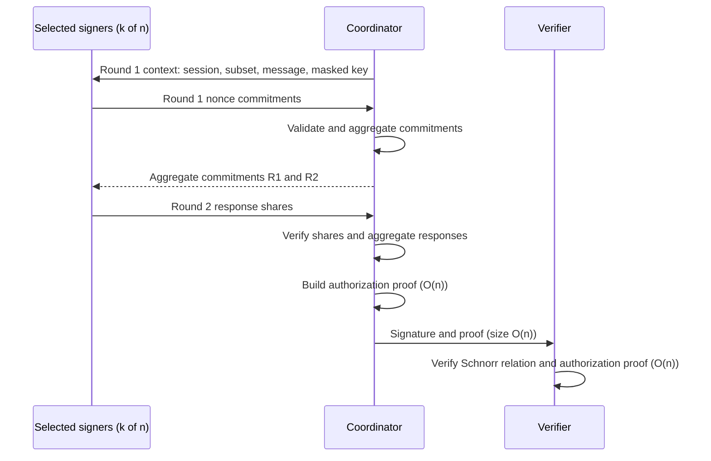
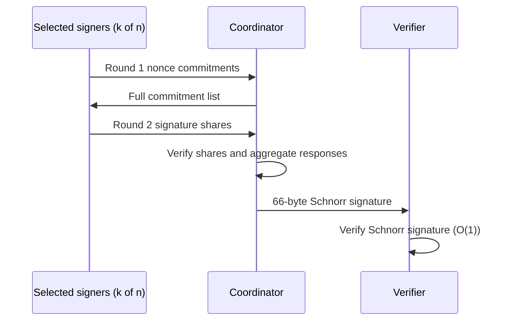
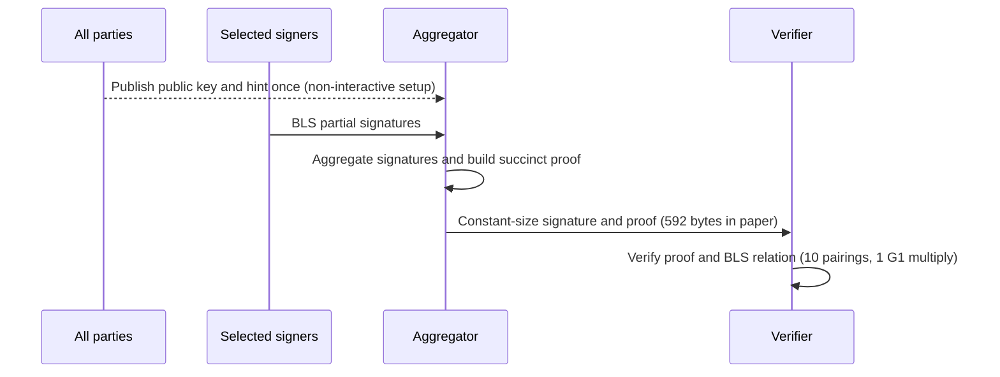

# Threshold Signature Benchmark Report

**Status:** exploratory research measurements. Audit v5 is the HTA scheme source. Results and tests do not establish security. This report presents each scheme separately because their setup, functionality, and measured stages differ.

## 1. Executive summary

The local HTA and FROST measurements use secp256k1 and matching `(n,t,k)` configurations. HTA adds a roster-based authorization proof: its signature size and full verification cost grow with `n`. FROST produces a compact Schnorr signature and has constant-size final verification. FROST round-two and share-check timings below include repeated commitment-list preparation by the measured API; they are not lower bounds for an implementation that reuses prepared values.

The local hinTS code run measures proof construction and proof-equation checks only. It does not measure complete hinTS signing or verification. Paper results are listed separately and were collected on different hardware.

## 2. Protocol and implementation profiles

### 2.1 HTA

| Item | Implementation detail |
|---|---|
| Group | secp256k1 prime-order group; compressed points are 33 bytes; scalars are 32 bytes. |
| Hashing | SHA-256 for typed, length-prefixed transcripts and domain-separated scalar challenges. Generator derivation uses RFC 9380 `secp256k1_XMD:SHA-256_SSWU_RO_`, DST `HTA-v1-secp256k1-Hgen`. |
| Backend | Pinned mcl public arithmetic; OpenSSL 3 for SHA-256 and randomness. Secret arithmetic is variable-time research code. |
| Protocol | Independent signer keys, two signing rounds, dynamic per-message threshold, roster-based authorization proof, share verification, and final verification. No DKG or pairing SRS. See audit v5 Algorithms 1–2 and checks C1–C4. |
| Measured optimizations | Randomized batch verification, generator cache, public fixed-base multiplication, public MSM component comparison, and proof-generator table experiment. Proof-generator tables remain disabled. |

### 2.2 FROST

| Item | Implementation detail |
|---|---|
| Source | [Bytemare FROST, pinned commit](https://github.com/bytemare/frost/tree/316cadd937fd546ac3b01bd36e837090b9b1f8f0), following [RFC 9591](https://www.rfc-editor.org/rfc/rfc9591.html#section-6.5). |
| Ciphersuite | `FROST(secp256k1, SHA-256)`, context `FROST-secp256k1-SHA256-v1`. H1–H3 use RFC 9380 XMD-to-scalar with `rho`, `chal`, `nonce` domains. H4/H5 use `msg` and `com`. |
| Key setup | The benchmark uses the library's trusted-dealer Shamir key generation and configuration setup; it does not run DKG. The threshold is fixed by the key configuration. |
| Signature | One compressed point and one scalar: 66 bytes. Runtime: Go 1.26.3. |

### 2.3 hinTS

| Item | Paper construction | Local repository code run |
|---|---|---|
| Source | [hinTS paper](https://eprint.iacr.org/2023/567.pdf). | [Upstream source commit](https://github.com/hintsrepo/hints/tree/930fd3cccd8caf08f16924bb6fe55611f3f1f2f6). |
| Group and hash | BLS12-381 (G1, G2, Fr), KZG SRS, BLS hash-to-curve. Paper cites CFRG hash-to-curve draft-12 and Arkworks. | Declares BLS12-381 and Arkworks 0.4 family. The measured functions do not call hash-to-curve. |
| Setup and threshold | Dynamic threshold; one-time per-party hints and KZG-based public state. | Hardcodes n=64, has no threshold input/check, and initializes with deterministic `test_rng`. Setup is outside the timed section. |
| Measured functionality | Full BLS signing and succinct certificate according to the paper. | `Proof` has no message or BLS signature; timed verifier checks proof equations only. This is a proof microbenchmark, not full hinTS signing or verification. Rust 1.99.1. |
| Size | Paper reports 9 G1 + 5 Fr = 592 bytes. | No serialization output. |

MiMC is used in the paper's separate SNARK/EdDSA comparison, not in its hinTS BLS construction.

## 3. Protocol flows

### 3.1 HTA

### 3.2 FROST

### 3.3 hinTS paper protocol

## 4. Asymptotic time and space complexity

Let `n` be roster size, `k` selected signers, `t` threshold, and `MSM(m)` an m-base multi-scalar multiplication. These are protocol/source bounds, not measured memory use. The FROST API costs observed in the benchmark are noted separately.

### 4.1 HTA complexity

| Phase or state | Time | Space |
|---|---|---|
| Key registration and roster | O(1) key/PoP per party; O(n) total validation | O(n) roster |
| Generator derivation | O(n) hash-to-curve calls for `2N+1` bases | O(n) generators |
| Signing | O(1) arithmetic per signer in two rounds; O(k) across signers, excluding context/subset parsing | O(1) key/nonces per live signer session |
| Aggregation and authorization proof | O(k) commitment/response sums; O(n) proof work using several O(n)-base MSMs | O(n) proof working state |
| Share and final verification | O(k) share checks; O(n) MSM/group and field terms for full verification | O(n) roster and proof/signature |
| Signature | O(n) | Measured size: 1,467 B at n=8; 5,833 B at n=64 |

### 4.2 FROST complexity

| Phase or state | Time | Space |
|---|---|---|
| Trusted-dealer setup | Approximately O(nt) field work for a degree-t sharing; DKG is outside RFC 9591 and this benchmark | O(n) public shares; O(1) secret share per signer |
| Round 1 | O(1) per signer; O(k) across signers | O(k) commitments at coordinator |
| Round 2 | Each signer processes k commitments; serialized total work is O(k²) in this benchmark | O(k) commitment list and shares |
| Share checks | O(k) with shared preparation. The measured API recomputes list preparation per share, making the measured loop O(k²). | O(k) session state |
| Final verification and signature | O(1) final verification and 66-byte signature | O(1) signature |

### 4.3 hinTS complexity from the paper

| Phase or state | Time | Space |
|---|---|---|
| Silent setup | Per-party hint generation: O(n) group multiplications and O(n log n) field work. Aggregator preprocessing: O(n²). | O(n) per-party hint; O(n²) total hints; O(n) CRS and aggregator key; O(1) verification key |
| Signing and aggregation | O(1) BLS partial signature per signer; O(n) online aggregate group work. Paper reports O(n/log n) for its Pippenger MSM component. | O(n) aggregator key/state; O(1) aggregate signature/proof |
| Verification | O(1) in n; paper reports 10 pairings and 1 G1 multiplication | O(1) verification key, in addition to CRS material |
| Signature | O(1) | Paper reports 592 bytes |

## 5. Measurement methodology

| Item | HTA | FROST |
|---|---|---|
| Host | Linux x86_64, Intel Core i5-1240P | Same host |
| Build | GCC 13.3, Release `-O3 -DNDEBUG`, mcl `9f49ba06593e2d426ab6fb9b0e17bc125a6f720c` | Go 1.26.3; pinned module checksums |
| Repetitions | 5 launches × 5 grouped samples × 5 sessions/group | 5 launches × 25 sessions after warmup |
| Execution | Signers sequential in one process | Signers sequential in one process |
| Setup measured | Deterministic test-key registration/PoP and roster validation; generator derivation excluded | Trusted-dealer keygen and configuration |

Values below are medians in milliseconds unless labeled otherwise. They are CPU-work measurements, not network or parallel latency. Peak RSS and complete wire traffic were not measured. Tables report medians and observed ranges where available; confidence intervals were not calculated.

## 6. HTA local results

### 6.1 End-to-end stages

Each column is a separate `(n,t,k)` configuration. HTA's full verification includes the authorization proof.

| Stage (ms unless noted) | 8,4,4 | 8,4,5 | 16,8,8 | 32,16,16 | 64,32,32 |
|---|---:|---:|---:|---:|---:|
| Registration and roster | 2.03 | 1.84 | 4.27 | 7.67 | 14.25 |
| Round 1 | 1.00 | 1.25 | 2.72 | 7.80 | 27.08 |
| Aggregate commitments | 0.34 | 0.40 | 0.60 | 1.08 | 2.14 |
| Round 2 | 0.45 | 0.57 | 0.93 | 1.82 | 3.84 |
| Verify shares | 0.76 | 0.96 | 1.56 | 3.09 | 6.52 |
| Aggregate responses | 0.098 | 0.100 | 0.102 | 0.105 | 0.116 |
| Authorization proof | 2.92 | 2.94 | 4.89 | 8.48 | 15.73 |
| Full verification | 1.90 | 1.90 | 2.97 | 4.86 | 8.60 |
| Serialized signature (bytes) | 1,467 | 1,467 | 2,133 | 3,391 | 5,833 |

The n=8 results have different k values but identical signature sizes, consistent with size depending on n rather than k. From n=8 to n=64, full verification grows from 1.90 ms to 8.60 ms and signature size from 1,467 B to 5,833 B.

## 7. FROST local results

### 7.1 End-to-end stages

Each column matches the HTA `(n,t,k)` configuration in Section 6. FROST final verification checks only its Schnorr signature; it does not include an HTA-style authorization proof.

| Stage (ms unless noted) | 8,4,4 | 8,4,5 | 16,8,8 | 32,16,16 | 64,32,32 |
|---|---:|---:|---:|---:|---:|
| Trusted-dealer setup | 32.23 | 31.97 | 94.03 | 310.45 | 1,143.55 |
| Round 1 commitments | 2.19 | 2.52 | 3.90 | 7.75 | 15.78 |
| Round 2 signature shares | 4.93 | 7.06 | 17.72 | 70.63 | 295.35 |
| Verify shares | 8.27 | 11.03 | 23.29 | 82.56 | 325.51 |
| Aggregate responses | 1.23 | 1.40 | 2.14 | 4.20 | 8.56 |
| Final Schnorr verification | 0.57 | 0.53 | 0.51 | 0.50 | 0.51 |
| Serialized signature (bytes) | 66 | 66 | 66 | 66 | 66 |

The measured `Sign` and `VerifySignatureShare` calls recompute binding factors and the group commitment from the full commitment list on each call. The Round 2 and share-check timings therefore reflect this API usage and are not lower bounds for an implementation that reuses prepared values.

### 7.2 Derived comparison at n=64, t=32, k=32

| Metric | HTA | FROST | Derived ratio |
|---|---:|---:|---|
| Setup | 14.25 ms | 1,143.55 ms | HTA 80.3× faster |
| Round 1 | 27.08 ms | 15.78 ms | FROST 1.7× faster |
| Round 2 | 3.84 ms | 295.35 ms | HTA 76.9× faster |
| Share checks | 6.52 ms | 325.51 ms | HTA 49.9× faster |
| Final verification | 8.60 ms | 0.51 ms | FROST 16.9× faster |
| Signature size | 5,833 B | 66 B | FROST 88× smaller |

These ratios describe this harness and API. They do not establish protocol-level superiority. HTA and FROST final verification evaluate different statements.

## 8. hinTS results

### 8.1 Local upstream-code pilot

The source hardcodes n=64 and the print-only instrumentation observed 58 bitmap entries. It uses deterministic test randomness and excludes setup. No threshold parameter, BLS signature, BLS verification, or serialization is exercised.

| Timed operation | Mean | Median | Observed range |
|---|---:|---:|---:|
| Proof construction only | 126.24 ms | 111.59 ms | 85.91–175.02 ms |
| Proof-equation verification only | 31.28 ms | 27.79 ms | 25.93–44.35 ms |

These are proof microbenchmark results, not full hinTS signing/verification timings.

### 8.2 Published paper measurements

Paper results use a separate M1 Pro, 32 GB environment and are not combined with local measurements.

| Operation | Paper result |
|---|---:|
| Silent setup | O(n log n); 46.3 s at n=210 (universal SRS is separate) |
| BLS signing | About 1 ms per signer |
| Aggregation | 0.06 / 0.13 / 0.23 / 0.47 s at n=128 / 256 / 512 / 1,024 |
| Verification | 17.5 ms |
| Signature and proof | 592 B |

## 9. HTA optimization experiments

### 9.1 Randomized batch verification

Same binary; batch verification compared with individual verification. Randomized batching has probabilistic soundness.

| Configuration | Individual checks | Batch checks | Speedup |
|---|---:|---:|---:|
| 8,4,4 | 1.81 ms | 1.54 ms | 1.18× |
| 8,4,5 | 1.88 ms | 1.58 ms | 1.19× |
| 16,8,8 | 2.98 ms | 2.33 ms | 1.28× |
| 32,16,16 | 4.68 ms | 3.75 ms | 1.25× |
| 64,32,32 | 8.30 ms | 6.47 ms | 1.28× |

Whole `bench` and `bench-reference` preset results also differ in generator caching and public fixed-base multiplication; those comparisons do not isolate batching.

### 9.2 Public generator fixed-base table

| Mode | Mean time per operation |
|---|---:|
| Direct multiplication | 120.367 µs |
| Fixed-base table | 36.146 µs |
| Derived speedup | 3.33× |

Collected over five launches and nine grouped samples. This is public generator multiplication only.

### 9.3 Proof-generator fixed-base table experiment

Four-bit tables cover `H0`, `G_i`, `H_i`, and roster keys. Per-operation table sums exclude decoding and scalar/base conversion, so these timings are optimistic relative to the existing MSM path.

| Roster n | Setup | Table memory | Repeated table sum | Existing MSM |
|---:|---:|---:|---:|---:|
| 8 | 98 ms | 4.9 MiB | 18.0 µs | 453 µs |
| 64 | 580 ms | 29.4 MiB | 128.7 µs | 2,207 µs |
| 256 | 2.12 s | 110.9 MiB | 585.5 µs | 7,674 µs |

Tables remain disabled pending integrated reuse and amortization measurements.

### 9.4 Public MSM backend component

| Backend path | 64-term MSM median |
|---|---:|
| mcl | 1.74 ms |
| libsecp256k1 public API | 3.45 ms |

The libsecp256k1 path performs per-term multiplication and point combination; it is not a native general MSM. This is a component comparison, not a full protocol backend comparison.

## 10. Interpretation and limitations

- HTA authorization proof and final verification scale with roster size; FROST final Schnorr verification remains constant-size and constant-work in n.
- The local FROST Round 2 and share-check measurements include repeated commitment-list preparation by the pinned library API.
- hinTS paper measurements and the local proof-only code pilot are different evidence and must remain separate.
- Peak RSS, complete wire traffic, parallel signer latency, and network behavior were not measured.
- Results are from one host and are exploratory. Medians and observed ranges are reported; confidence intervals were not calculated.
- Phase 5 remains open for full protocol backend comparison, hinTS end-to-end benchmarking, larger controlled/multi-host runs, the 24-hour fuzz run, and expert review.

## 11. Reproducibility and sources

- HTA [optimized matrix](docs/benchmarks/phase5-hta-frost-matrix-20261109/) and [reference matrix](docs/benchmarks/phase5-hta-reference-frost-matrix-20261109/).
- FROST [raw matrix](docs/benchmarks/phase5-frost-matrix-20261109.jsonl), [pinned driver](bench/frost-baseline/), and [RFC 9591](https://www.rfc-editor.org/rfc/rfc9591.html).
- hinTS [local pilot data](docs/benchmarks/phase5-hints-20261109.jsonl), [upstream commit](https://github.com/hintsrepo/hints/tree/930fd3cccd8caf08f16924bb6fe55611f3f1f2f6), and [paper](https://eprint.iacr.org/2023/567.pdf).
- Related work, not benchmarked: [Dyna-hinTS](https://eprint.iacr.org/2025/631) and [ePrint 2026/1820](https://eprint.iacr.org/2026/1820).
